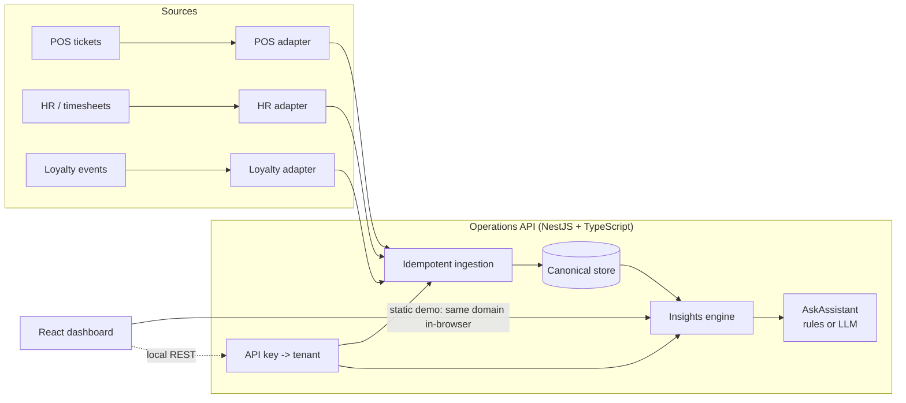

# Restaurant operations platform PoC

**Live demo: https://restaurant-ops-poc.web.app** (static browser build, fictional sample data)

An independent proof of concept by Mohamed Abo Elmagd for multi-location restaurant groups: ingest
POS sales, labor timesheets and loyalty events into one canonical model, compute KPIs and
anomalies, and answer “ask your data” questions without letting vendor payloads leak through the
stack. NestJS / TypeScript API + React dashboard.
**All data in the seed is fictional.** Names are marked `(sample)`.

### About the live demo

Firebase Hosting is static, so the live site is a **browser demo build** of the same React app:
the domain layer (`backend/src/domain` — ingest, insights, the rule-based assistant) is imported
directly and runs in your browser against two seeded tenants. Switch groups, filter a location,
ask a question, then click **Replay sample POS ticket** twice to see idempotent ingestion.
**Reset demo** restores the sample window. The NestJS API is the real backend; run it locally or
with Docker (see [Run it](#run-it)).

## The problem

A restaurant group usually already has a POS, a staff scheduler, a loyalty programme and an
accounting tool. Each one speaks a different dialect: store codes, ticket ids, clock punches,
points ledgers. Finance and operations still ask the same questions every morning:

| Question | Why it is hard by hand |
|---|---|
| How did each location trade yesterday? | Sales live in the POS; the “store code” is not the name on the P&L |
| Is labor in line with sales? | Hours live in HR; rates may be weekly; nobody joins them to tickets |
| When is the rush? | Tickets are a firehose; peak hours need a single clock |
| Did something odd happen? | A banquet, a mapping error, or a quiet weekday all look like “a number” |
| Can I just ask the data? | Spreadsheets do not keep up; a raw LLM over guest rows is the wrong default |

Goal: normalise the feeds once, isolate every tenant, auto-compute the KPIs that operators
already trust, queue the rest as anomalies with a clear reason, and let people ask questions
against those KPIs.

## What is in the box

- **Domain layer** (`backend/src/domain`): pure TypeScript — in-memory store, idempotent ingest,
  insights, rule-based assistant. The React demo and the NestJS API share this code; it is not copied.
- **Connector SDK** (`backend/src/connectors`): a `normalize()` port plus mock POS, HR and loyalty
  adapters, and HMAC-SHA256 webhook verification.
- **API** (`backend/src/http`): NestJS on Express, multi-tenant by API key, demo reset endpoint.
- **Postgres schema** (`backend/src/db/migrations/001_init.sql`): tenant → brand → location,
  orders, line items, labor shifts, customers, loyalty events, ingestion cursors.
- **Dashboard** (`frontend`): React 19 + Vite. KPI cards, sales-by-location, peak hours, anomaly
  list, integrations status, ask-your-data box, tenant and location switchers.
- **Sample data**: two fictional tenants — Northshore Dining Group (a kitchen brand with New Cairo
  and Maadi sites, plus a Downtown espresso bar) and Atlas Hospitality (Atlas Grill in Heliopolis
  and Sheikh Zayed). Seven-day window starting 27 October 2026.

## Run it

Requirements: Node.js 22+.

```bash
npm run setup          # installs backend + frontend
npm test               # Jest: normalisation, isolation, ingest, insights, webhooks
npm run dev:api        # NestJS on http://localhost:3000
npm run dev:web        # Vite on http://localhost:5173 (proxies /api)
```

Demo API keys: `demo_northshore_key`, `demo_atlas_key`.

```bash
# build the static demo (what Firebase Hosting serves)
npm run build:demo
```

### Docker

```bash
docker compose up --build
```

Postgres starts with the canonical schema mounted from `001_init.sql` (useful to inspect tables).
The API boots with the in-memory demo store so you can explore endpoints immediately; point
`DATABASE_URL` at the database when you wire a persistent adapter on top of the same SQL.

### Try the API with curl

```bash
K='x-api-key: demo_northshore_key'; B=http://localhost:3000/api/v1
curl -s $B/me -H "$K"
curl -s $B/locations -H "$K"
curl -s "$B/insights?locationId=loc_nsk_md" -H "$K"
curl -s -XPOST $B/insights/ask -H "$K" -H 'content-type: application/json' \
  -d '{"question":"Which location has the highest labor cost?"}'

# Signed webhook (HMAC-SHA256 of the raw body). Replaying the same ticket_id is a no-op.
BODY='{"ticket_id":"NSK-NC-DEMO-REPLAY","store_code":"NSK-NC","closed_at":"2026-11-02T15:42:00.000Z","guests":2,"service":"dine_in","items":[{"sku":"NSK-PST","item_name":"Truffle mushroom pasta","qty":2,"unit_price":"295.00"}],"totals":{"subtotal":"590.00","tax":"82.60","discount":"0.00","grand":"672.60"},"currency":"EGP"}'
SIG=$(node -e "const {createHmac}=require('crypto');const b=process.argv[1];console.log('sha256='+createHmac('sha256','whsec_demo_northshore').update(b).digest('hex'))" "$BODY")
curl -s -XPOST $B/integrations/pos/events -H "$K" -H "x-webhook-signature: $SIG" -H 'content-type: application/json' -d "$BODY"
```

The webhook secret `whsec_demo_northshore` is a documented fixture for this PoC, not a real credential.

## Architecture



A longer write-up lives in [docs/ARCHITECTURE.md](docs/ARCHITECTURE.md).

## Insights and anomalies

`computeInsights` is pure. On the seeded Northshore window it reports net sales, order counts,
average ticket, covers, labor cost % and loyalty activity per location, a 24-hour peak histogram,
and a daily series. Anomaly rules shipped with the PoC:

| Flag | Rule |
|---|---|
| Labor cost above target | ≥ 35% of net sales (warning), ≥ 42% (critical) |
| Sales dip | A location-day more than 25% below that location’s own daily average |
| Unusually large ticket | More than 8× the average ticket (banquet — or a mapping error) |

Maadi is seeded with heavier staffing so labor % lights up; New Cairo has a quiet day; Heliopolis
includes a banquet package so the outlier rule has something real to point at.

**Ask your data.** The default assistant is rule-based and offline. Setting `LLM_API_KEY` (and
optionally `LLM_BASE_URL` / `LLM_MODEL`) swaps in an OpenAI-compatible client behind the same
interface. The model only sees aggregated KPIs, never raw guest rows, and any failure falls back
to the rules. It cannot write to the store.

## Multi-tenancy, ingest and security notes

- **Tenant isolation**: every record has `tenant_id`, every query filters on it, and the tenant
  comes only from the API key. A location code that belongs to another tenant is rejected.
  Cross-tenant reads do not confirm that foreign ids exist. Covered by Jest tests.
- **Idempotent ingestion**: `(tenant_id, connector, external_id)` is unique. Replaying a webhook
  returns `replayed: 1` and leaves a single order.
- **Webhook signatures**: `HMAC-SHA256` over the raw body (or `timestamp.body` when
  `x-webhook-timestamp` is sent). Compared with `timingSafeEqual`.
- **AI safety**: the optional model never mutates data and only receives the KPI snapshot.
- PoC shortcuts (see next steps): demo keys are public, there is no end-user SSO, the API store
  is in-memory unless you persist via the SQL schema.

## Stack choices

- **NestJS** for the HTTP boundary because that is the backend shape most TypeScript platform
  teams already run (modules, guards, raw-body webhooks). The interesting logic sits *under*
  Nest in a framework-free domain folder, so the same functions run in the browser demo and in
  Jest.
- **In-memory store + portable SQL.** The demo must start with one command and no native
  modules. The Postgres migration is the production schema; docker-compose mounts it.
- **React + Vite** for the dashboard (static export to Firebase Hosting). Charts are plain DOM so
  the bundle stays small.
- **Jest** for unit tests of normalisation, isolation, replay, signatures and insights.

## Next steps for production

1. Postgres + RLS, run migrations in CI, a real `PostgresStore` implementing `OpsStore`.
2. Auth: OIDC/SSO for operators, API keys with rotation and scopes for connectors, RBAC
   (operator vs finance vs integrator).
3. Real adapters: POS webhooks, HR exports, loyalty events, plus an accounting daily-close feed.
   Outbox + retries + a dead-letter queue per tenant.
4. Broader insights: food cost once accounting lands, prep-list suggestions, staffing vs forecast,
   weather / event covariates.
5. LLM: prompt/response logging to an audit trail, PII redaction, cost budgets, offline eval
   against the rule engine before enabling a tenant.
6. Ops: the existing Dockerfile, OpenTelemetry, structured logs, backups/PITR, data residency.

## Decision records

- [ADR-0001: Shared-schema tenancy](docs/adr/0001-shared-schema-tenancy.md)
- [ADR-0002: Canonical model and connector SDK](docs/adr/0002-canonical-model-and-connectors.md)
- [ADR-0003: Rule-based insights first, LLM behind an interface](docs/adr/0003-ai-insights-fallback.md)

Also see [How I used AI coding tools](docs/HOW-I-USED-AI-CODING-TOOLS.md).

## License

MIT © 2026 Mohamed Abo Elmagd
