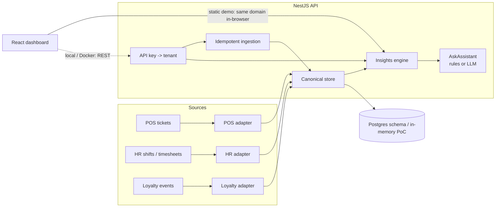

# Architecture

This document describes the proof-of-concept restaurant operations platform: a multi-tenant
SaaS foundation that ingests operational events from several vendor systems, stores them in a
canonical model, and exposes KPIs plus a guarded “ask your data” interface.

## Goals

- One tenant hierarchy: **tenant → brands → locations**.
- Vendor-specific payloads never leak into the rest of the product. Adapters map them into a
  small canonical model (orders, line items, labor shifts, customers / loyalty events).
- Insights and the assistant read only the canonical model, so a new POS or an accounting feed
  later does not rewrite the dashboard.
- The live demo must run as a static site. The same TypeScript domain layer that the NestJS API
  uses is imported by the React app and executed in the browser.

## Multi-tenancy

Shared database, shared schema, `tenant_id` on every business table (see `backend/src/db/migrations/001_init.sql`).

- The tenant is resolved once per request from the `x-api-key` header. It is never taken from the
  URL or the JSON body.
- Every store method takes `tenantId` as its first argument and every lookup of a location code is
  scoped to that tenant. A foreign location code is rejected, not silently attached to another site.
- Cross-tenant reads return empty / 404 rather than 403, so the API does not confirm that another
  tenant’s ids exist.
- Production add-on: Postgres Row-Level Security (`SET LOCAL app.tenant_id`) as defence in depth,
  plus per-tenant encryption keys if a customer requires it. Very large or regulated tenants can
  later move to a dedicated database with the same schema.

The in-memory store used by this PoC (and by the static demo) implements the same isolation rules
so they can be unit-tested without Postgres.

## Canonical data model

```
Tenant
  └── Brand
        └── Location  (externalCodes used by vendor feeds: "NSK-NC", …)
              ├── Order + LineItem     ← POS connector
              ├── LaborShift           ← HR / timesheet connector
              └── LoyaltyEvent ── Customer
```

Money is stored as integer minor units (piastres for EGP). Timestamps are ISO-8601. Channels are
`dine_in | takeaway | delivery`. Order status is `closed | voided` (voids stay in the log so they
do not disappear from audits).

## Connector SDK

`backend/src/connectors` defines a `Connector<TRaw, TDraft>` port:

```ts
interface Connector<TRaw, TDraft> {
  kind: 'pos' | 'hr' | 'loyalty';
  vendor: string;
  normalize(payload: TRaw): NormalizeResult<TDraft>;
}
```

Three mock adapters ship with the PoC:

| Feed | Vendor-ish payload | Canonical output |
|---|---|---|
| POS sales | `ticket_id`, `store_code`, `items[]`, `totals`, `service` | `CanonicalOrderDraft` |
| HR shifts | `shift_id`, `site`, `employee_code`, `clock_in/out`, `wage_per_hour` | `CanonicalShiftDraft` |
| Loyalty | `event_id`, `member_id`, `event` (`earn`/`accrual`/`redeem`/`burn`), `pts` | `CanonicalLoyaltyDraft` |

Ingestion is idempotent on `(tenant_id, connector, external_id)`. Replaying the same webhook
increments `replayed` and does not create a second order. Webhooks are signed with HMAC-SHA256
(`x-webhook-signature: sha256=<hex>`, optional `x-webhook-timestamp`); the raw body is what is
signed, never the parsed JSON.

An accounting connector (journal entries, daily close) would implement the same port and write
into additional canonical tables. The insights module would then pick up cost-of-goods without
changing POS or HR adapters.

## Insights and AI

`computeInsights` is a pure function: given a tenant snapshot (optionally filtered by location) it
returns totals, a per-location breakdown, a 24-hour peak histogram, a daily series and a list of
anomalies.

Current anomaly rules:

- Labor cost % ≥ 35 warning, ≥ 42 critical.
- A location-day more than 25% below that location’s own daily average.
- A single ticket more than 8× the average (possible banquet — or a mapping error).

“Ask your data” sits behind an `AskAssistant` interface.

- `RuleBasedAskAssistant` (default) answers from the KPI snapshot with keyword routing. It is
  deterministic and needs no network.
- `LlmAskAssistant` is optional. It posts *aggregated* KPIs — not raw guest rows or connector
  secrets — to any OpenAI-compatible endpoint when `LLM_API_KEY` is set. Failures fall back to the
  rule engine. The model never writes to the store.

That split is the foundation for later automation (suggested prep lists, staffing nudges, anomaly
explanations) without letting a model become the system of record.

## Security notes

- Demo API keys and webhook secrets are public and documented; treat them as fixtures, not
  credentials.
- No secrets are committed. `.env` is gitignored; `.env.example` lists names only.
- Input validation lives in the adapters (required ids, ISO timestamps, positive quantities).
- Production would add OIDC/SSO, RBAC (operator vs finance vs integrator), key rotation, rate
  limits, raw-body size caps, and an append-only audit log of ingestions and assistant calls.

## Runtime topology



```
backend/src/domain/     types, store, ingest, insights, ask, seed (no Nest, no I/O)
backend/src/connectors/ Connector port + mock POS / HR / loyalty + HMAC helper
backend/src/http/       NestJS controllers and tenant guard
backend/src/db/migrations  portable SQL for Postgres
frontend/src/           React dashboard; demo.ts imports the domain layer
docs/adr/               architecture decision records
```
